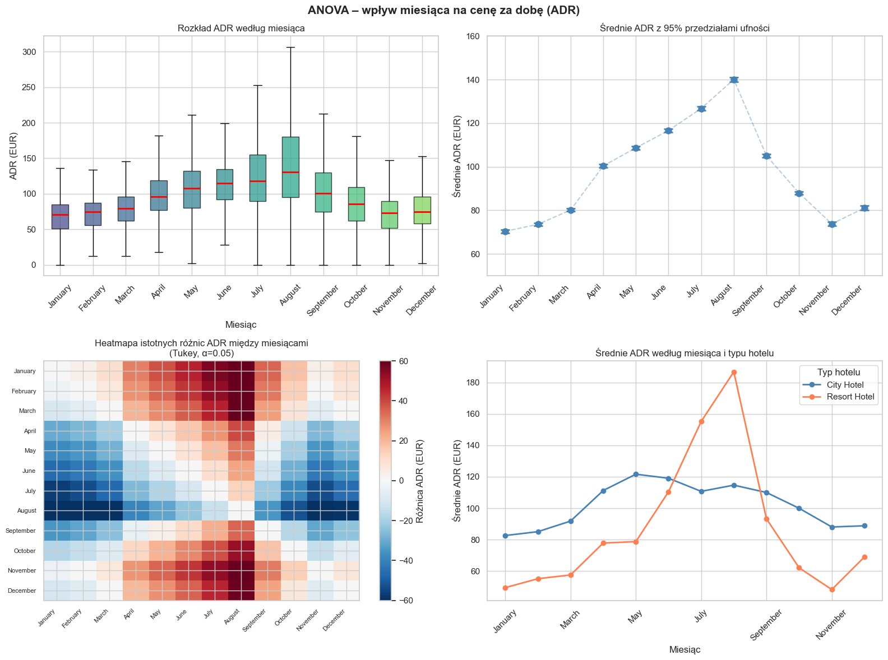
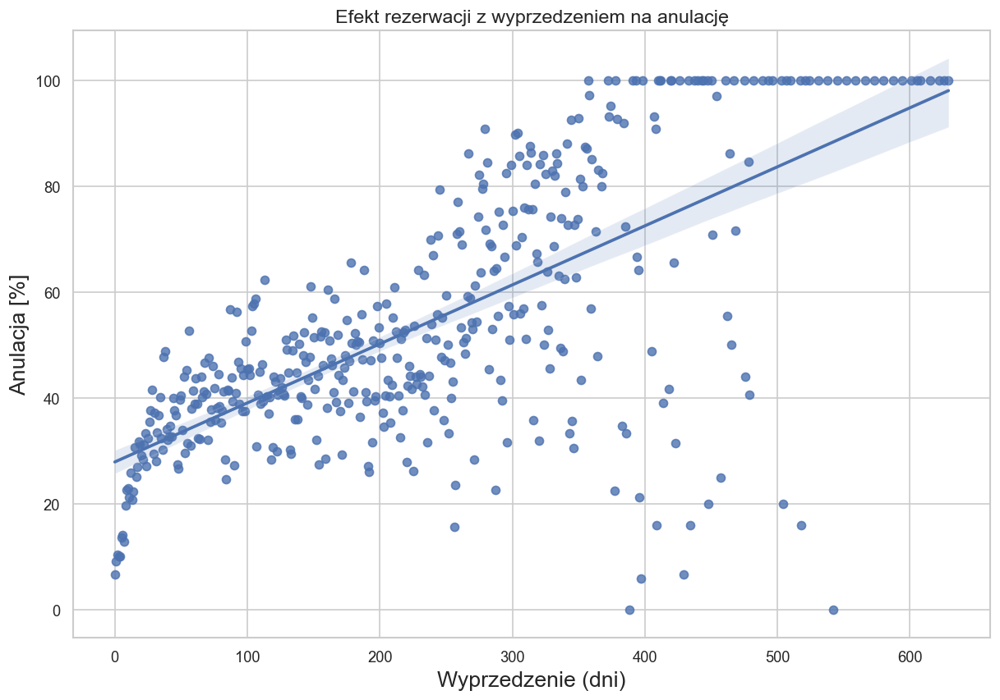
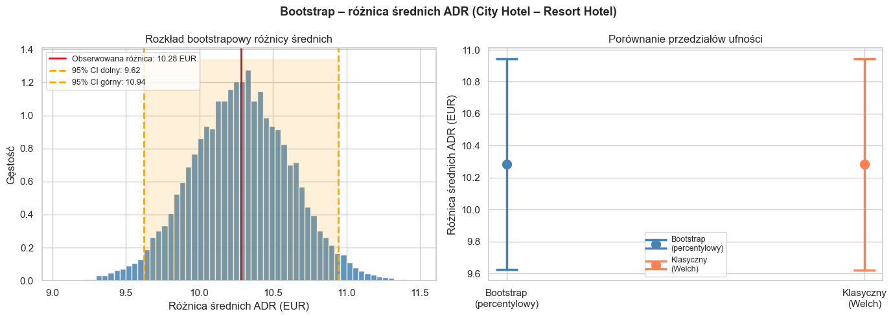

# Hotel Booking Demand: Exploratory & Statistical Analysis

An analysis of **119,390 real hotel bookings** (July 2015 – August 2017) from a city hotel and a resort hotel. Part 1 explores the data. Part 2 uses statistical inference to find what drives the **average daily rate (ADR)** and cancellations.

 

> Notebooks and chart labels are in Polish.

## Notebooks

| Notebook | Content |
|---|---|
| `01_exploratory_analysis.ipynb` | data quality, missing values, descriptive statistics, interactive visualisations (Plotly) |
| `02_statistical_inference.ipynb` | hypothesis testing, bootstrap, ANOVA |

## Research questions & answers

| # | Question | Method | Answer |
|---|---|---|---|
| Q1 | Does ADR differ between city and resort hotels? | Mann-Whitney U, bootstrap CI | **Yes.** Median ADR is 99.90 € (city) vs 75.00 € (resort). |
| Q2 | Is ADR normally distributed? | Shapiro-Wilk, Q-Q plot | **No.** It is right-skewed, so non-parametric methods were used. |
| Q3 | Is cancellation independent of hotel type? | χ² test of independence | **No.** 41.7% of city hotel bookings are cancelled vs 27.8% at the resort. |
| Q4 | Does ADR differ between arrival months? | Welch ANOVA, Kruskal-Wallis, Tukey HSD | **Yes.** Month explains about 21% of ADR variance (η² = 0.21). |

## Key insights

- **Seasonality is the main price driver.** August averages 140 €/night and January 70 €/night.
- **The resort hotel is much more seasonal**, from about 50 € in winter to about 185 € in peak summer. In the summer peak it is more expensive than the city hotel.
- The **overall cancellation rate is 37.5%**, and **lead time** is its strongest predictor. Cancellations rise steadily with how far in advance the booking was made:

  

- **The bootstrap confirms the price gap.** City hotel ADR is on average 10.28 € higher than at the resort (95% CI: 9.62–10.94 €), consistent with the classical Welch interval:

  

- Booking behaviour also differs by distribution channel and customer type.

## Tech stack

Python · pandas · NumPy · SciPy · statsmodels · Matplotlib · Seaborn · Plotly · Jupyter

## Data

[Hotel Booking Demand](https://www.kaggle.com/datasets/jessemostipak/hotel-booking-demand) (Kaggle). Originally published in: Antonio, N., Almeida, A., Nunes, L. (2019). *Hotel booking demand datasets.* Data in Brief, 22, 41–49.

Download `hotel_bookings.csv` and place it next to the notebooks to run them.
